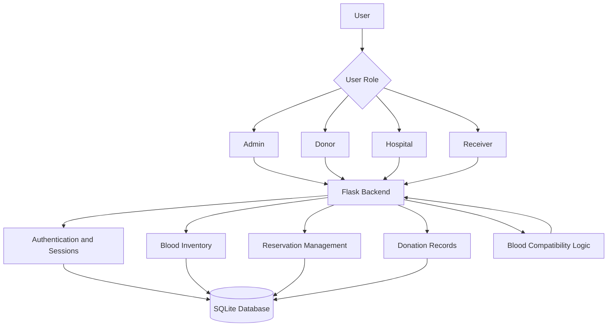

# Blood-Bank-Reservation-System

<div align="center">


<br/>


<br/><br/>


<br/><br/>

**A web-based blood bank management application designed to simplify blood inventory management, donor registration, and blood reservation workflows.**

[Explore Repository](https://github.com/tejassri-sm/Blood_Bank_Reservation_System) · [Report an Issue](https://github.com/tejassri-sm/Blood_Bank_Reservation_System/issues)

</div>

---

## `01` // PROJECT OVERVIEW

The **Blood Bank Reservation System** is a Python Flask web application that brings blood donors, receivers, hospitals, and administrators together through a centralized platform.

The system supports blood inventory management, reservation requests, donation records, and role-based access to help organize essential blood bank operations.

### 🎯 Project Objectives

- Simplify blood donation and reservation workflows.
- Maintain organized blood inventory records.
- Provide separate dashboards for different user roles.
- Support blood-group compatibility checks.
- Improve visibility into reservations and inventory status.

---

## `02` // KEY FEATURES

<table>
<tr>
<td width="50%" valign="top">

### 👨‍💼 Admin Dashboard

- Manage blood inventory.
- Monitor reservations and donation records.
- Review system activity.
- Access administrative functions.

</td>
<td width="50%" valign="top">

### 🩸 Donor Dashboard

- Access donor-related features.
- Manage donation information.
- Track donation history where available.
- Support donor eligibility workflows.

</td>
</tr>
<tr>
<td width="50%" valign="top">

### 🏥 Hospital Dashboard

- Access hospital-related functionality.
- Work with blood reservation workflows.
- View relevant inventory and request information.

</td>
<td width="50%" valign="top">

### ❤️ Receiver Dashboard

- Access blood reservation features.
- Select the required blood group.
- Check compatible blood-group options.
- Follow the reservation workflow.

</td>
</tr>
</table>

### ⚡ Additional Functionality

- **Role-based access control** for protected pages.
- **Password hashing** using Werkzeug security utilities.
- **Session management** using Flask-Session.
- **Blood-group compatibility logic**, including a Bombay blood-group entry.
- **Reservation priority handling** and notification-related database models.

---

## `03` // TECHNOLOGY STACK

<div align="center">


</div>

| Technology | Purpose |
|---|---|
| Python | Application logic and backend development |
| Flask | Web framework and routing |
| Flask-SQLAlchemy | Database integration and ORM |
| SQLite | Persistent database storage |
| Flask-Session | Server-side session management |
| Werkzeug | Password hashing and security utilities |
| HTML5 | Web page structure |
| CSS3 | User interface styling |
| Git and GitHub | Version control and source management |

---

## `04` // SYSTEM ARCHITECTURE



---

## `05` // PROJECT STRUCTURE

```text
Blood_Bank_Reservation_System/
│
├── app.py
├── blood_bank.py
├── models.py
├── requirements.txt
│
├── instance/
│   └── blood_bank.db
│
├── static/
│   └── css/
│       └── style.css
│
├── templates/
│   ├── base.html
│   ├── index.html
│   ├── login.html
│   ├── register.html
│   ├── admin_dashboard.html
│   ├── donor_dashboard.html
│   ├── hospital_dashboard.html
│   └── receiver_dashboard.html
│
└── README.md
```

---

## `06` // RUN LOCALLY

Follow these steps to run the application on your computer.

### Prerequisites

- Python 3.10 or later recommended.
- pip package manager.
- Git (optional, for cloning the repository).

### Step 1 — Clone the repository

```bash
git clone https://github.com/tejassri-sm/Blood_Bank_Reservation_System.git
cd Blood_Bank_Reservation_System
```

### Step 2 — Create a virtual environment

```bash
python -m venv venv
```

Activate it on Windows:

```powershell
.\venv\Scripts\Activate.ps1
```

Or, using Command Prompt:

```bat
venv\Scripts\activate
```

### Step 3 — Install dependencies

```bash
pip install -r requirements.txt
```

### Step 4 — Configure the application

Before running the application, ensure the Flask secret key is configured securely using an environment variable and that the database initialization code is available.

**Security note:** Never use a development secret key in a public deployment. Keep production secrets out of source control.

### Step 5 — Start the application

The repository contains both `app.py` and `blood_bank.py`. Use the entry point that initializes the database and runs the Flask server. If `app.py` is configured as the main entry point, run:

```bash
python app.py
```

Open the local URL printed in your terminal, typically:

```text
http://127.0.0.1:5000/
```

> If the database tables have not been initialized, initialize them using the database setup supported by the project before opening the application.

---

## `07` // DATABASE MODELS

The application defines database models for its core workflows, including:

- **User** — user accounts and role information.
- **BloodInventory** — blood stock information.
- **Reservation** — blood reservation records.
- **DonationHistory** — donor-related records.
- **Notification** — notification-related data.

The application uses SQLite through Flask-SQLAlchemy.

---

## `08` // LEARNING OUTCOMES

Working on this project provides practical experience with:

- Building web applications using Flask.
- Connecting Python applications to a relational database.
- Implementing authentication and role-based authorization.
- Organizing application logic using database models.
- Managing sessions and user-specific dashboards.
- Developing workflows for inventory and reservation management.
- Structuring a multi-page web application.

---

## `09` // FUTURE ENHANCEMENTS

Potential improvements for future versions:

- Real-time blood stock availability.
- Email or SMS notifications.
- Advanced blood inventory analytics.
- Search and filtering by location and blood group.
- Improved reservation status tracking.
- Automated tests and stronger input validation.
- Deployment with production-grade security.
- Responsive interface improvements for mobile devices.

---

## `10` // CONTRIBUTIONS

Suggestions, bug reports, and improvements are welcome.

1. Fork this repository.
2. Create a feature branch.
3. Commit your changes.
4. Open a pull request describing your improvement.

---

<div align="center">

## 🩸 CODE WITH PURPOSE. BUILD TO SAVE LIVES.

**Developed by Tejas Sri S. M.**

<a href="https://github.com/tejassri-sm">

</a>

<br/><br/>


<sub>DONATE BLOOD // SPREAD HOPE // SAVE LIVES</sub>

</div>
